  

 

  

 

  

    
  

  

    Hi there! I'm <strong>Jose Regish J</strong> (<code>@hackerjose25</code>) — a passionate <strong>Full-Stack Developer</strong> and <strong>Web3 / Blockchain Engineer</strong> studying at <strong>Loyola-ICAM College of Engineering and Technology (LICET)</strong>, Chennai. Like Spider-Man swinging through the city, I build robust, high-performance web applications, architect decentralized protocols with <strong>Solidity &amp; Smart Contracts</strong>, and secure digital infrastructures with razor-sharp <strong>Spider-Sense</strong>.
  

  

    
    &nbsp;
    
    &nbsp;
    
    &nbsp;
    
  

 

  

 

  

 

  <h2>🕸️ MULTIVERSE TECH ARSENAL</h2>
  
<em>"Battle-tested weapons, frameworks, and decentralized protocols powering production apps."</em>

 

<table align="center" width="100%">
  <tr>
    <td width="33%" valign="top">
      <h3 align="center">🔗 Web3 &amp; Blockchain Core</h3>
      

        &nbsp;
        &nbsp;
        
      

      

        &nbsp;
        &nbsp;
        
      

      

        <b>Solidity · Smart Contracts · EVM · DApps · DeFi · Web3.js</b>
      

    </td>
    <td width="33%" valign="top">
      <h3 align="center">⚡ Full-Stack Frontend</h3>
      

        &nbsp;
        &nbsp;
        
      

      

        &nbsp;
        &nbsp;
        
      

      

        <b>React.js · Next.js · TypeScript · Modern ES6+ · Responsive UI</b>
      

    </td>
    <td width="33%" valign="top">
      <h3 align="center">🛡️ Backend, DB &amp; Tools</h3>
      

        &nbsp;
        &nbsp;
        
      

      

        &nbsp;
        &nbsp;
        
      

      

        <b>Node.js · Express · Python · MongoDB · MySQL · Blender 3D</b>
      

    </td>
  </tr>
</table>

 

  

 

  <h2>🚀 MULTIVERSE PROTOCOLS // FEATURED PROJECTS</h2>
  
<em>"Real-world decentralized applications, smart contract protocols, and full-stack solutions."</em>

 

### 🕸️ [AgentPay](https://github.com/hackerjose25/AgentPay)
> **Autonomous AI Agent Financial Rails & Web3 Settlement Protocol**
- **Architecture:** Decentralized infrastructure enabling autonomous software agents to execute programmatic micro-payments and settle on-chain transactions via smart contracts.
- **Technologies:** `Solidity` · `TypeScript` · `Web3.js` · `Smart Contracts` · `EVM`
- **Domain:** <kbd>● WEB3 & BLOCKCHAIN</kbd> &nbsp; <kbd>● SMART CONTRACTS</kbd>

 

### 💼 [JosePortfolio](https://github.com/hackerjose25/JosePortfolio) &nbsp; 🔗 [Live Preview](https://jose-portfolio-pi.vercel.app)
> **Modern Cybernetic Developer Portfolio**
- **Architecture:** Interactive personal portfolio showcasing full-stack capabilities, web apps, and design projects with ultra-responsive UX and seamless transitions.
- **Technologies:** `React` · `JavaScript` · `CSS3` · `Vercel`
- **Domain:** <kbd>● FULL-STACK WEB</kbd> &nbsp; <kbd>● LIVE PRODUCTION</kbd>

 

### 🚨 [Safety360](https://github.com/hackerjose25/safety360)
> **Real-Time Emergency SOS & Automated Police Telemetry Matrix**
- **Architecture:** Mission-critical emergency safety system. Upon one-tap trigger, user GPS coordinates, live video stream, and telemetry are transmitted in real time directly to the emergency dispatch dashboard.
- **Technologies:** `JavaScript` · `Node.js` · `WebRTC` · `Geolocation API` · `Express`
- **Domain:** <kbd>● FULL-STACK WEB</kbd> &nbsp; <kbd>● IOT & TELEMETRY</kbd>

 

### 🛡️ [Vulnerability-Scanner](https://github.com/hackerjose25/Vulnerability-Scanner)
> **Automated Exploit Detection & Security Assessment Suite**
- **Architecture:** Automated security scanner engineered to probe endpoints for web vulnerabilities, misconfigured headers, and security loopholes before malicious entities find them.
- **Technologies:** `Python` · `Network Security` · `Socket Programming` · `Cyber Defense`
- **Domain:** <kbd>● CYBER DEFENSE</kbd> &nbsp; <kbd>● AUDITING</kbd>

 

### 🌐 [NetSense](https://github.com/hackerjose25/NetSense)
> **Intelligent Network Traffic & Threat Anomaly Monitor**
- **Architecture:** High-throughput network packet analyzer inspecting anomalous traffic flows and suspicious connection patterns in real time.
- **Technologies:** `TypeScript` · `Packet Inspection` · `Data Telemetry`
- **Domain:** <kbd>● FULL-STACK</kbd> &nbsp; <kbd>● TELEMETRY</kbd>

 

### 🧠 [HealthTracker-AI](https://github.com/hackerjose25/HealthTracker-AI)
> **Predictive Biometric Analytics & Smart Health Companion**
- **Architecture:** Machine-learning powered health monitoring engine providing proactive personal analytics and smart wellness diagnostics.
- **Technologies:** `JavaScript` · `React` · `Python` · `Machine Learning`
- **Domain:** <kbd>● FULL-STACK AI</kbd> &nbsp; <kbd>● BIOMETRICS</kbd>

 

  

 

  <h2>📊 SPIDER-SENSE TELEMETRY // LIVE GITHUB STATS</h2>
  
<em>"Real-time diagnostic stream measuring commit velocity, language mastery, and streak intensity."</em>

 

  
  &nbsp;&nbsp;
  

  

 

  <h3>🎮 PACMAN CONTRIBUTION MATRIX</h3>
  <picture>
    <source media="(prefers-color-scheme: dark)" srcset="https://raw.githubusercontent.com/hackerjose25/hackerjose25/output/pacman-contribution-graph-dark.svg">
    <source media="(prefers-color-scheme: light)" srcset="https://raw.githubusercontent.com/hackerjose25/hackerjose25/output/pacman-contribution-graph.svg">
    
  </picture>

 

  <h3>🎵 SPIDER-SUIT AUDIO FEED // SPOTIFY</h3>
  

 

  

 

  <h2>🌐 SPIDER-NET COMMUNIQUE // CONNECT WITH JOSE</h2>
  
<em>"Building decentralized protocols, full-stack systems, or looking for an impactful engineer? Let's connect!"</em>

   

  

    
    &nbsp;&nbsp;
    
    &nbsp;&nbsp;
    
    &nbsp;&nbsp;
    
    &nbsp;&nbsp;
    
    &nbsp;&nbsp;
    
    &nbsp;&nbsp;
    
  

 

  

